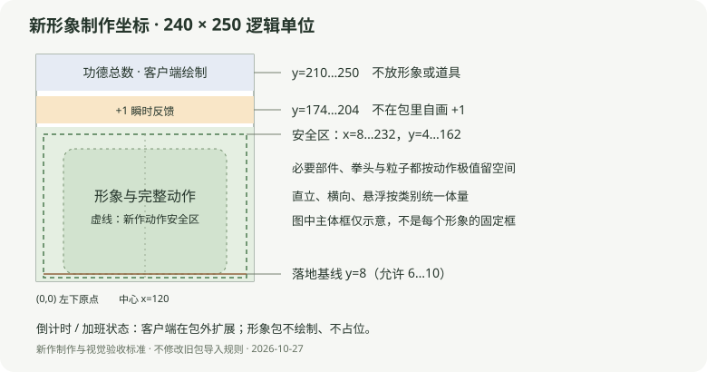

# 新作视觉形制

从仓库权威视觉规范的当前章节生成。客户端及规范摘要见 client-baseline.json。

## 新作统一形制（2026-10-27，当前制作标准）

本节替代旧“裁切后宽 150–220、高 120–170、统一 y=0 基线”的制作要求，适用于今后新作和明确重制的版本。数值是本次产品设计选择，不是从历史包统计得到的事实；不批量改旧包，不新增客户端导入拒绝规则。技术硬边界、官方新作的视觉验收和开放 DIY 的创作建议分别处理。

### 区域与坐标

所有下列数值为包的**逻辑单位**，左下为原点；不是固定的屏幕像素或 Windows DIP。设备缩放和窗口比例由客户端处理，不在包内按平台另写坐标。

| 区域 | 范围 | 规则 |
|---|---|---|
| 完整包画布 | x=0..240，y=0..250 | 现有协议，不变 |
| 形象硬边界 | x=0..240，y=0..170 | 人物、手、道具、阴影与粒子全部在此显示；不得依赖裁切隐藏错误 |
| 新作动作安全区 | x=8..232，y=4..162 | 所有必要可见内容在完整动作中保留左右各 8、顶部 8、底部 4 的余量 |
| 功德瞬时反馈 | y=174..204 | 客户端绘制；形象包不得放自己的 +1 |
| 功德总数 | y=210..250 | 客户端绘制；形象包不得绘制、遮挡或替换数字 |
| 倒计时/加班状态 | 包画布之外的客户端独立扩展区 | 包内不写时间、状态栏、留白占位或平台专属补偿；开启前后形象内部构图不变 |

Mac 与 Windows 候选的倒计时区域具体高度不同，本标准不宣称它们像素布局相同，不修改该 UI。网页版截图的裁切方式也不能反向决定客户端包坐标。

### 静止体量与定位

按主要实体的**可见轮廓**衡量，不按 PNG 外接方框，也不把金币、零星粒子或长工具末端拿来撑大体量。作者在制作验收记录中说明主体由哪些层/部位组成；不在 manifest 新增字段，不根据 body/base 文件名自动推断。

| 构图类别 | 新作默认体量 | 定位 |
|---|---|---|
| 直立/近方形角色 | 主体高度 128–146；宽度随原比例，通常不超过 184 | 落地实体的接地点 y=8，允许 6–10；主体轮廓中点 x=120±8 |
| 横向/低矮器物 | 主体宽度 164–204；高度随原比例，通常不超过 138 | 接地点 y=8，允许 6–10；主体轮廓中点 x=120±8 |
| 飞行/悬浮/悬挂角色 | 主体长边 140–180，不强行拉成方形 | 主体轮廓中点 x=120±8、y=83±8；无需落地基线 |

“主体轮廓中点”是几何辅助，不是人的感知重心。重头、细柄、偏侧道具需要在同尺寸对照中确认视觉重量；允许整体在上述定位范围内微调。极细长/特殊形状先保证比例及动作安全，交付时注明采用的构图与例外，不通过非等比拉伸硬凑表格。官方新作采用这些默认规格或明确记录视觉例外；开放 DIY 不因体量偏好被客户端拒绝。

默认落地基线比安全区下沿高 4 个单位，可给轻微动作留空间；需要更大下沉、摆动或向上举手时，先按完整动作收缩/调整构图。不能为了保持静止体量而裁掉拳头、耳朵或动作终点。必要部件需要越出安全区时先改动作或整体布局，不靠遮挡数字解决。

### 动作、遮挡与复杂形变

- 检查静止、预备、发力、回弹和收势全部阶段，以及连续输入改变速度后的衔接；完整动作安全优先于静止图“撑满”。
- 每个可见像素（含前景、后景、粒子、运动模糊）都受形象硬边界约束。软发光应在安全区内衰减，不能以“很透明”把必要内容塞进数字区。
- 固定支撑物不动；可动角色可转头、抬手、跳跃、整体倾斜，图层名称不限制角色。关节衔接不露洞、重影或断肢；道具进入容器时由真实前景遮挡。
- 姿态图之间必须保持同一画布、主体基准、关节与受光关系。完整帧序列按整段最大范围构图，不逐帧自动居中或自动适配，否则会漂移。
- 新的姿态切换/多动作播放器仍未实现；本节规定未来素材应满足的形制，不改变现有 schema。当前形象只能使用双端已经支持的变换与插值。

### 视觉语言与小尺寸可读性

默认延续有体积感的桌面小摆件风格、清晰轮廓和统一主要光向。材质、色系、角色类别可以变化；不强制全暖色、单材质或固定部件数。一个角色内部的静止图、部件与替换姿态必须像同一个物体，不能拼成不同光照、透视或锐度的零件。

用浅色、深色和接近角色颜色的中性背景检查透明边缘；主体需要不透明的区域保持实心，有意的玻璃、光效、羽毛边缘保留半透明。不能全图统一提升 alpha。阴影如存在，计入同一动作边界，不另加会遮挡文字的地板。

至少检查 240×170 与 120×85 两种显示尺度，后者用于发现缩小后不可辨认的动作和细节，不代表两端固定窗口大小。主要连接处建议至少约 4 个逻辑单位，轮廓清晰优先于装饰纹理。道具铭文可以存在，但不得依靠小字解释核心动作，也不添加宣传文案、水印或自己的功德/时间界面。

### 预览与交付验收

- 新作 preview 输出 480×340 的透明 PNG，对应 240×170 逻辑形象区；从 manifest 静止姿态生成，不含计数、+1、倒计时。旧预览尺寸继续按既有兼容规则处理。
- 官网、客户端选择器和运行中的角色使用同一构图；网页可以按上方网页衍生规则优化图片，不能为某个角色另外放大、移动或换封面姿态。
- 新作交付包括：构图类别/主体说明、静止预览、完整动作循环预览、主要动作极值画面，以及是否存在视觉例外。循环预览是验收材料，不要求客户端空闲循环播放。
- 测量输出：静止可见联合边界、采样动作联合边界、水平中心、距四边留白、越过硬边界或安全区的提示。图像测量不是自动识别人物主体，也不证明连续时间无裁切；通过原生/网页整段播放确认。
- 官方新作视觉验收：无必要部件裁切、无数字/时间遮挡、同类体量协调、边缘干净、动作衔接正确。格式检查通过不能代替这些结果；开放 DIY 对应给出建议，不追加平台签名要求。

